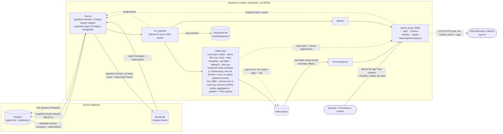
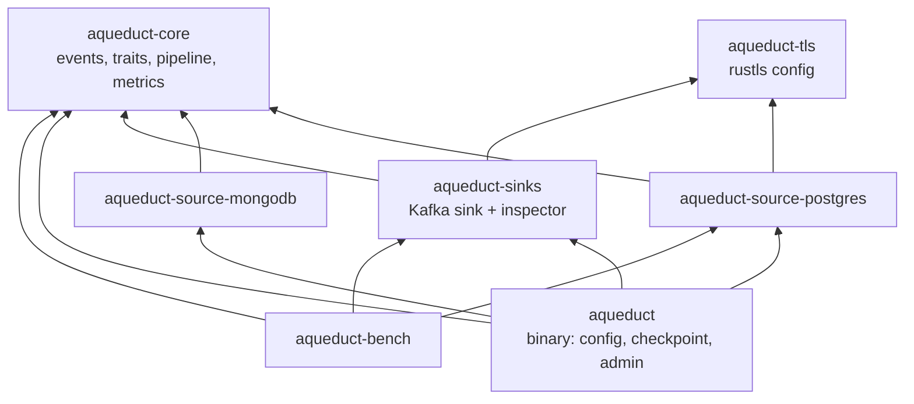

# Architecture

One process runs one pipeline: a **source**, the **Kafka sink**, a **checkpoint file** and the **admin server**,
all inside one container.



## Delivery: at-least-once

The checkpoint is written and the source acknowledged only after Kafka has acknowledged the whole batch and every
batch before it. Up to `sink.in_flight_batches` (4) batches are produced at once; each partition writes them in order
through one lane with one request outstanding ([ADR 0004](adr/0004-pipelined-kafka-produce.md)). A crash before the
checkpoint replays the batches since it, so consumers must tolerate duplicates.

```mermaid
sequenceDiagram
    autonumber
    participant S as Source
    participant P as run_pipeline
    participant K as Kafka sink
    participant C as Checkpoint file
    Note over P,C: startup: load checkpoint, source.start(position)
    loop until shutdown
        P->>S: next() + try_next() (up to 1000 events)
        S-->>P: batch of ChangeEvents
        P->>K: submit(batch): records queued on their partitions' lanes
        Note over P,K: up to in_flight_batches submitted; the source reads ahead meanwhile
        K-->>P: oldest batch acked (60 s from submit)
        P->>C: save(its last position) (tmp file, fsync, rename)
        P->>S: ack(its last position)
        Note over S: Postgres: slot advances only to a commit-end LSN
    end
```

Heartbeat events (MongoDB, idle or filtered streams) never reach the sink. They only move the checkpoint.

## Crates


