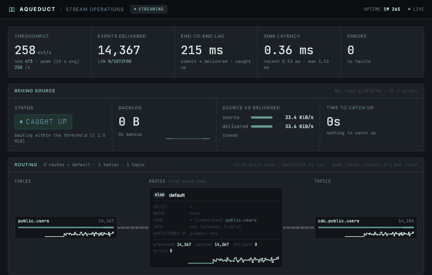

# Admin cockpit

The HTTP port serves a web console at `/`: whether Aqueduct is **behind its source** and when it catches up,
throughput, lag, sink latency, errors, a **routing graph**, per-table high-water marks and an **event inspector**
(a sample of the newest events read from Kafka). Open `http://host:8080/#token=<admin_token>`; the fragment is never
sent to the server.

Every panel explained: [deep dive: cockpit](deep-dive/cockpit.md).

The recording uses the compose stack with generated demo rows.

| Route | Purpose |
|-------|---------|
| `GET /`, `/admin.css` | The dashboard (public) |
| `GET /healthz` | Liveness; used by the image `HEALTHCHECK` |
| `GET /readyz` | `200` while streaming, else `503` |
| `GET /metrics` | Prometheus (`aqueduct_*` series) |
| `GET /api/metrics`, `/api/stream` | JSON snapshot; Server-Sent Events, one per second |
| `GET /api/routes`, `/api/routes/history` | Compiled route plan with live counts; the last 300 s of rates |
| `GET /api/kpis/history` | The top tiles' last 300 s, one sample per second |
| `GET /api/tables` | Per-table high-water marks and topic offsets |
| `GET /api/events?topic=<t>&limit=<n>` | Newest events read from Kafka |
| `GET`/`POST`/`DELETE /api/snapshot` | Snapshot status, start (`{"tables": [...]}`), cancel |

## Security

- On a non-loopback `health_addr`, startup refuses without `admin_token` (unless `admin_insecure_no_auth = true`).
- With a token, `/metrics` and `/api/*` need `Authorization: Bearer <token>`. `?token=` is rejected.
- **Events contain row data.** Keep the port on a trusted network or behind a TLS reverse proxy, or set `inspector = false`.
- Without a token, requests from other sites (foreign `Host` or `Origin`, non-JSON `POST`) are refused.
- At most 64 connections; a reserve always answers `/healthz` and `/readyz`.
